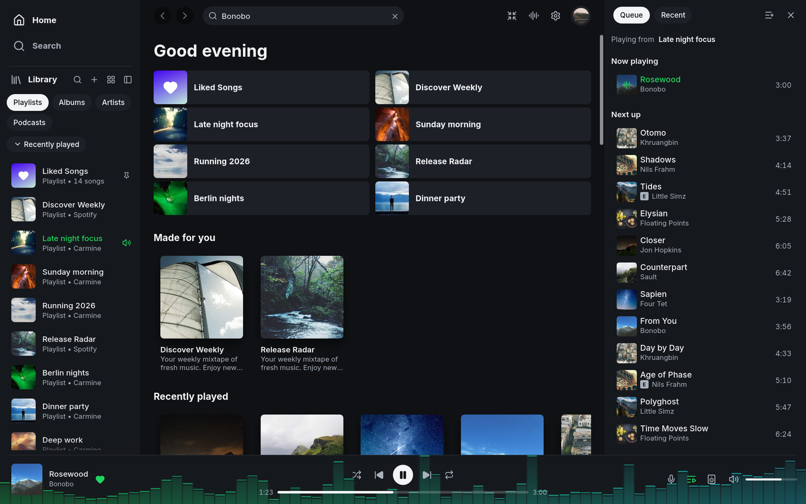
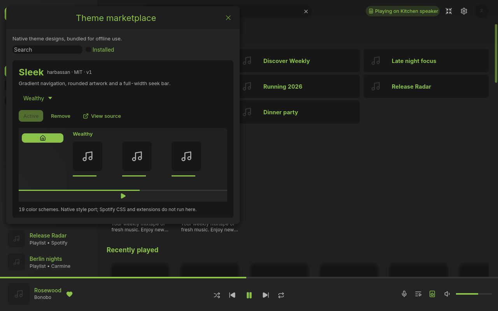
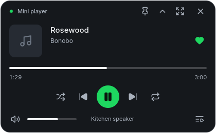

<p align="center">
  
</p>

<h1 align="center">Spotifast Personal Version</h1>

<p align="center"><strong>Spotify, native and fast.</strong><br>A lightweight music app for Linux, macOS, and Windows.</p>

<p align="center">
  <a href="#build-this-personal-version"><strong>Build this version</strong></a> ·
  <a href="docs/_guide/getting-started.md">Getting started</a> ·
  <a href="docs/_guide/using-spotifast.md">User guide</a> ·
  <a href="CONTRIBUTING.md">Contribute</a>
</p>

<p align="center">
  <a href="Cargo.toml"></a>
  <a href="https://spotifast.rocks/download/"></a>
  <a href="LICENSE"></a>
</p>

Spotifast is a Spotify client written in Rust with
[egui](https://github.com/emilk/egui). It plays music through
[librespot](https://github.com/librespot-org/librespot), typically uses
100–250 MB of RAM, starts in well under a second, and has no browser engine.

This repository is a personal version of [Spotifast](https://github.com/crmne/spotifast).
Its `main` branch includes the modern themed mini player, Spicetify color-scheme
import, and the native theme marketplace with Sleek. MilkDrop and the Winamp
mini-player interface have been removed.

**Playback needs Spotify Premium.** Free accounts can browse and search, but
cannot play music through Spotifast.



<details>
<summary><strong>Watch Spotifast in action</strong></summary>

https://github.com/user-attachments/assets/a5f669ce-b3b7-4f8e-9933-976a78876c7e

</details>

[Features](#your-music-on-your-desktop) · [Build this version](#build-this-personal-version) · [First playback](#start-listening) · [Themes](#theme-marketplace-and-spicetify-themes) · [Mini player](#the-mini-player) · [Demo](#preview-without-a-spotify-account) · [Help](#guides-and-help)

## Your music, on your desktop

| Feature | What you can do |
|---|---|
| **Library and search** | Browse playlists, Liked Songs, albums, artists, and podcasts. Search the catalogue and edit playlists you own. |
| **Spotify Connect** | Play on this computer or control playback on your other devices. |
| **Themes** | Install the native Sleek design with 19 schemes, import Spicetify `color.ini` palettes, or choose light, dark, system and custom colours. On Omarchy, follow your desktop theme. |
| **Desktop controls** | Use keyboard shortcuts and media keys. Keep music playing from the tray when supported by your desktop and settings. |
| **Mini player** | Album art, playback controls, seeking, and volume in a compact window that follows your theme. |

## Build this personal version

Install Git and Rust 1.98 or newer. Windows also needs the Visual Studio C++
build tools; Linux needs the audio and windowing development packages listed
in [Build from source](docs/_guide/getting-started.md#build-from-source).

Clone this repository's `main` branch and launch the regular app:

```sh
git clone --branch main https://github.com/htristan16/Spotifast-PersonalVersion.git
cd Spotifast-PersonalVersion
cargo run --locked
```

For an existing checkout, update before running:

```sh
git fetch origin
git switch main
git pull --ff-only
cargo run --locked
```

To build an executable:

```sh
cargo build --locked --release
```

On Windows, launch `target\release\spotifast.exe`. On Linux and macOS, launch
`target/release/spotifast`. The executable opens the regular app; demo mode
requires the `demo` feature and launch flags shown [below](#preview-without-a-spotify-account).

### Upstream packages

The downloads and package-manager commands below install upstream Spotifast.
They do not include this repository's personal-version changes. Build from
this repository to use the modern mini player and native Sleek marketplace.

| Platform | Installation |
|---|---|
| **macOS** | `brew install --cask crmne/tap/spotifast`, or [download the Mac app](https://spotifast.rocks/download/#macos). |
| **Arch Linux** | `yay -S spotifast-bin` |
| **Windows** | Choose your build on the [Download page](https://spotifast.rocks/download/). |
| **Other Linux** | Find Flatpak, AppImage, Nix, and other options on the [Download page](https://spotifast.rocks/download/). |

## Start listening

1. Open Spotifast and choose **Sign in with Spotify**. Approve access in your
   browser, then return to the app to see your library.
2. To listen on this computer, open the device menu in the bottom player bar
   and choose **Set up playback here**, also available in Settings.
3. Complete the separate playback approval in your browser. Your computer
   appears as a Spotify Connect device named **Spotifast**.

Library access and local playback have separate approvals. Spotifast remembers
both using your computer's protected storage. See
[Getting started](https://spotifast.rocks/getting-started/) for the full walkthrough
and [How it connects](https://spotifast.rocks/how-it-connects/) for the details.

## Theme marketplace and Spicetify themes

Open **Settings > Appearance > Theme marketplace > Browse themes**.
Install **Sleek**, preview any of its 19 color schemes, then click **Apply**.
This native port recreates Sleek's gradient sidebar, rounded artwork, track
styling, transparent playback controls and full-width seek bar. The bundled
catalog works offline and saves your selection across restarts. Remove a
package from the marketplace or choose another appearance under **Theme**.

The first catalog contains Sleek. More designs need native ports; Spotify's
Marketplace extensions and arbitrary CSS do not run in Spotifast.



You can also import a downloaded theme's `color.ini` from the same Settings
row, then choose any imported scheme under **Theme**.
The colors apply to the main window and mini player. CSS and JavaScript
are not imported. [Read the import guide](docs/_reference/settings-and-files.md#import-spicetify-themes).

## The mini player

A sleek compact player that follows the main window's theme, with album art,
playback controls, seeking, volume, and a return to your queue. Switch with
**Ctrl+M** (**Cmd+Shift+M** on macOS), the shrink button, or Settings.
Use **Compact view** for an even smaller window, and pin it above other windows.



[Read the mini player guide](docs/_guide/mini-player.md) for controls and settings.
MilkDrop has been removed from this personal version.

## Preview without a Spotify account

Demo mode uses sample library and playback data. Build it with the `demo`
feature, then choose the interface you want to preview:

```sh
# Sleek and the native theme marketplace
cargo run --locked --features demo -- --demo --demo-show marketplace,sleek

# Sleek mini player
cargo run --locked --features demo -- --demo --demo-show sleek,mini-player

# Compact mini player
cargo run --locked --features demo -- --demo --demo-show sleek,mini-player,shade
```

To launch a demo executable directly on Windows:

```powershell
cargo build --locked --release --features demo
.\target\release\spotifast.exe --demo --demo-show marketplace,sleek
```

Running that executable without `--demo` opens the regular app. In the regular
app, choose **Install > Apply** in the marketplace to enable Sleek, and use
**Ctrl+M** to switch to the mini player. Demo mode does not play Spotify audio.

[View the theme comparison](docs/assets/native-theme-marketplace-review/index.html)
or [compare the mini player layouts](docs/assets/mini-player-review/index.html).

## Guides and help

The complete guide lives at **[spotifast.rocks](https://spotifast.rocks/)**.
The hosted guides describe upstream Spotifast. For this version's additions,
use the [mini player guide](docs/_guide/mini-player.md) and
[native theme marketplace guide](docs/_reference/settings-and-files.md#native-theme-marketplace).

| You want to… | Read |
|---|---|
| Sign in, set up playback, or configure themes, fonts, and proxies | [Getting started](https://spotifast.rocks/getting-started/) |
| Learn shortcuts, command-line controls, and updates | [Everyday use](https://spotifast.rocks/using-spotifast/) |
| Find configuration and stored files | [Settings and files](https://spotifast.rocks/settings-and-files/) |
| Understand what is stored and sent | [Privacy](https://spotifast.rocks/privacy/) · [How it connects](https://spotifast.rocks/how-it-connects/) |
| Check Spotify and librespot limitations | [What Spotify allows](https://spotifast.rocks/what-spotify-allows/) |
| Understand account risk | [Will my account get banned?](https://spotifast.rocks/what-is-spotifast/#will-my-spotify-account-get-banned) |
| Report a bug or propose a feature for this version | Read [Contributing](CONTRIBUTING.md), then use this repository's [issue forms](https://github.com/htristan16/Spotifast-PersonalVersion/issues/new/choose). |

## Contributing

Read [CONTRIBUTING.md](CONTRIBUTING.md) before opening an issue or pull
request. To look at the interface without a Spotify account, run:

```sh
cargo run --locked --features demo -- --demo
```

Translations live in `assets/i18n/`; see
[Translating Spotifast](docs/_reference/translating.md). Release packaging
is described in [PACKAGING.md](PACKAGING.md).

## More native apps

**Want WhatsApp just as fast and native?** [ZapFast](https://zapfast.rocks)
is Spotifast's sibling. Both are built on
[fastframe](https://github.com/crmne/fastframe).

## Acknowledgements

Spotifast uses [librespot](https://github.com/librespot-org/librespot),
[egui](https://github.com/emilk/egui), the [Inter](https://rsms.me/inter/)
typeface (OFL), and [Lucide](https://lucide.dev) icons (ISC).
The native Sleek theme uses [harbassan's Spicetify Sleek design](https://github.com/spicetify/spicetify-themes/tree/c432012478e1f2e2ffccca8e943e188af40d6190/Sleek)
and its 19 color schemes, with the [MIT license and attribution](assets/themes/sleek/README.md) included.

Spotifast is an independent project and is not affiliated with Spotify.
Spotify is a trademark of Spotify AB.

Licensed under the [MIT License](LICENSE).
